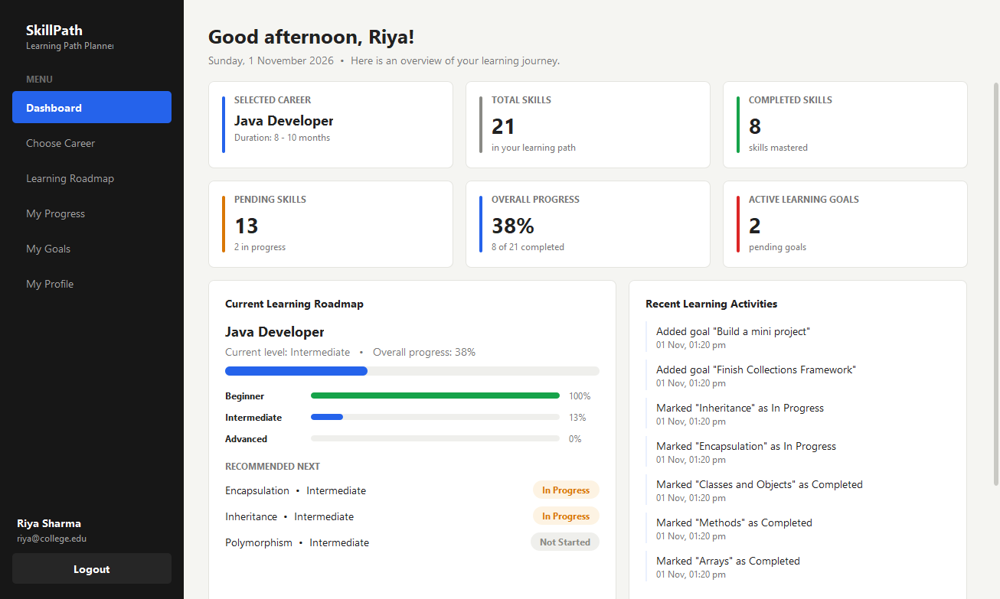
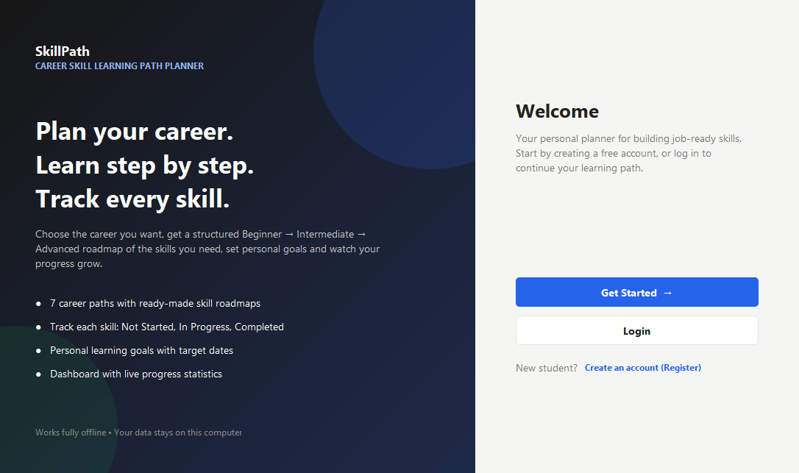
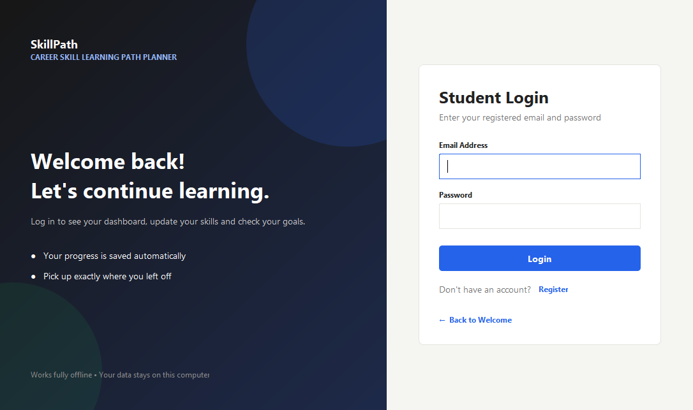
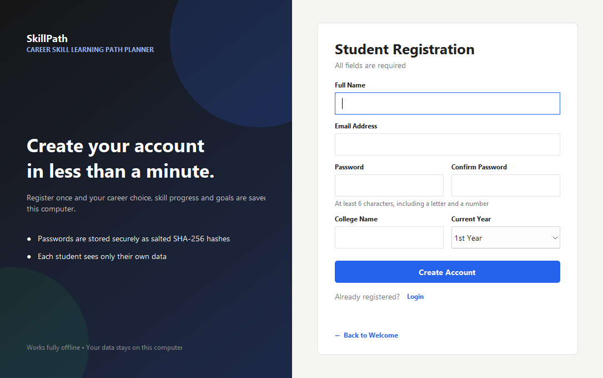
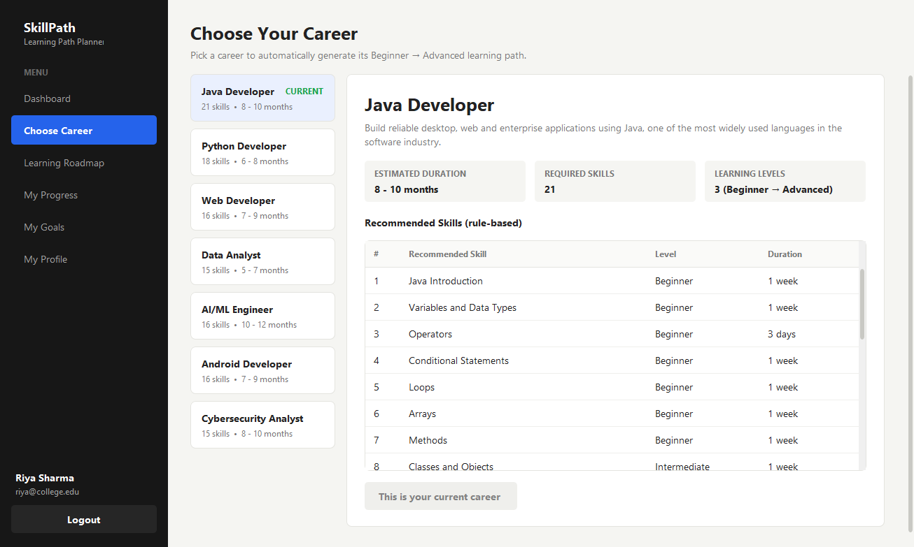
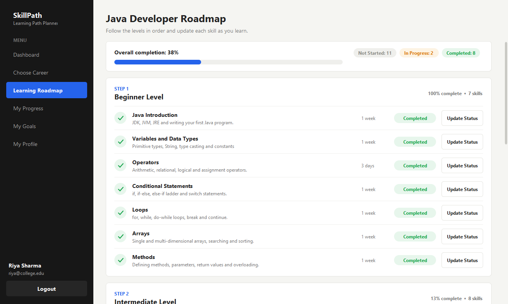
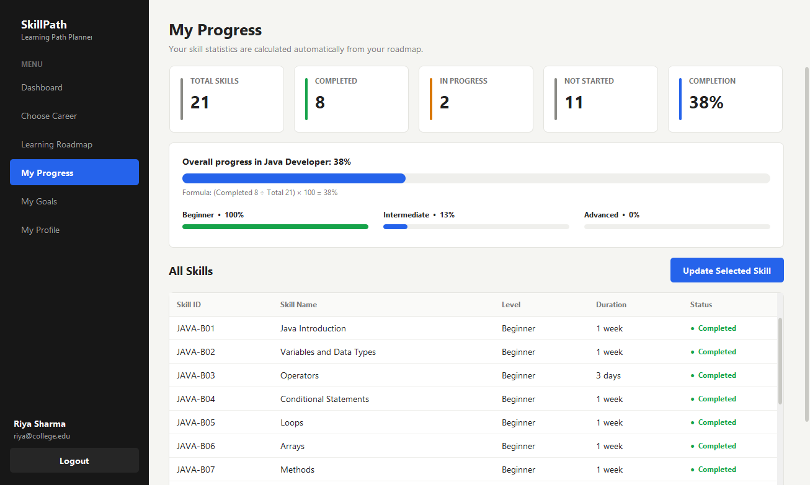
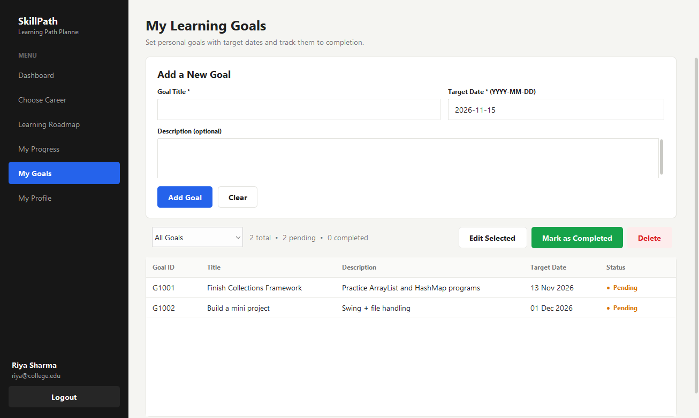
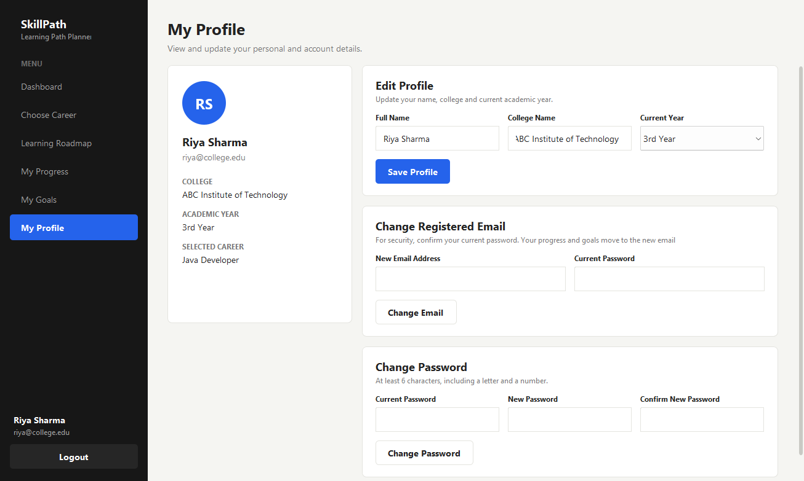

# Trajectory — Career Skill Learning Path Planner

A Core Java desktop application (Java Swing + file handling) that helps students choose a career, follow a structured skill roadmap, set learning goals and track their progress.



---

## 1. Project Introduction

Many students know *which* job they want (for example "Java Developer") but do not know *which skills* to learn, *in what order*, or *how far along* they are. The **Trajectory** application solves this. The student picks a career, the application generates a Beginner → Intermediate → Advanced roadmap of skills, and the student marks each skill as *Not Started*, *In Progress* or *Completed*. The dashboard then shows live statistics and the overall completion percentage.

The whole application is written in **Core Java**. It runs offline and stores all data in text files.

## 2. Problem Statement

Students preparing for a career often:

- do not know which skills a career needs,
- learn topics in a random order,
- have no simple way to see how much they have finished,
- forget the personal targets they set for themselves.

There is a need for a simple, offline tool that gives a **clear skill roadmap**, **tracks progress** and **manages learning goals** for each student separately.

## 3. Project Objectives

1. Let students register and log in securely (passwords are hashed).
2. Offer 7 career options, each with a predefined, realistic skill roadmap.
3. Recommend skills automatically using rule-based logic (no AI).
4. Organise skills into Beginner, Intermediate and Advanced levels.
5. Let students update the status of every skill and save it permanently.
6. Calculate progress using: **Progress % = (Completed Skills ÷ Total Skills) × 100**.
7. Let students add, update, complete and delete personal learning goals.
8. Keep every student's data separate (user isolation).
9. Demonstrate core Java concepts: OOP, collections, exceptions, file handling and Swing.

## 4. Technology Stack

| Item | Used |
|---|---|
| Language | Java (JDK 17 or newer) |
| GUI | Java Swing with custom-painted components |
| Layouts | BorderLayout, CardLayout, GridLayout, GridBagLayout, BoxLayout, FlowLayout |
| Storage | Plain text files in the `data` folder |
| Collections | `ArrayList`, `HashMap` (`LinkedHashMap`) |
| Security | `MessageDigest` (SHA-256), `SecureRandom`, `Base64` |
| IDE | IntelliJ IDEA or Eclipse (no extra libraries needed) |

No Spring, no database, no internet, no external libraries.

## 5. Features

| Module | What it does |
|---|---|
| Welcome Screen | App name, description, **Get Started**, **Login** and **Register** buttons |
| Registration | Full name, email, password, confirm password, college, year. Validates every field, blocks duplicate emails, hashes the password, saves to `students.txt` |
| Login | Checks email and password hash, shows clear errors, opens the dashboard and remembers the logged-in student |
| Dashboard | Greeting with the student's name; 6 live cards (career, total, completed, pending, progress %, active goals); roadmap summary with progress bars; "recommended next" skills; recent activities; quick-action buttons |
| Career Selection | 7 careers with description, required skills, levels and duration. Select or change career (with confirmation) |
| Skill Recommendation | Rule-based: shows the predefined skills of the chosen career and recommends what to learn next |
| Learning Roadmap | Skills grouped in Beginner / Intermediate / Advanced cards with name, description, duration, coloured status badge and an **Update Status** button |
| Progress Tracking | Total / Completed / In Progress / Not Started / %; overall and per-level progress bars; full skill table; shows the formula |
| Goal Management | Add, view, edit, mark completed and delete goals; filter pending/completed; date validation; overdue goals highlighted |
| Profile | View details; edit name, college, year; change email (needs current password); change password |
| Logout | Clears the session and returns to the login screen. All data stays saved |

Careers included: **Java Developer, Python Developer, Web Developer, Data Analyst, AI/ML Engineer, Android Developer, Cybersecurity Analyst**.

## 6. Project Structure

```
Trajectory/
├── src/
│   ├── main/
│   │   └── Main.java                    Starts the application
│   ├── model/                           Data classes
│   │   ├── Persistable.java             Interface: object can be saved as a file record
│   │   ├── User.java                    Abstract parent of Student
│   │   ├── Student.java                 Student details + selected career
│   │   ├── Career.java                  Career with its list of skills
│   │   ├── Skill.java                   One skill of a roadmap
│   │   ├── SkillStatus.java             Enum: NOT_STARTED, IN_PROGRESS, COMPLETED
│   │   ├── LearningPath.java            A student's skills grouped by level (HashMap)
│   │   ├── Goal.java                    A personal learning goal
│   │   └── Activity.java                One "recent activity" entry
│   ├── repository/                      File storage
│   │   ├── FileManager.java             Reads/writes records safely (escaping, temp file)
│   │   ├── StudentRepository.java       students.txt
│   │   ├── SkillRepository.java         progress.txt
│   │   ├── GoalRepository.java          goals.txt
│   │   └── ActivityRepository.java      activities.txt
│   ├── service/                         Business logic
│   │   ├── AppServices.java             Creates and shares all services
│   │   ├── AuthenticationService.java   Register, login, logout, profile, email, password
│   │   ├── CareerService.java           Career catalogue (HashMap) + career selection
│   │   ├── RecommendationService.java   Rule-based recommendation + learning path
│   │   ├── ProgressTracker.java         Status updates + progress calculation
│   │   └── GoalManager.java             Goal add/update/complete/delete
│   ├── gui/                             Swing screens
│   │   ├── BaseFrame.java               Parent of all windows
│   │   ├── WelcomeFrame.java            Module 1
│   │   ├── RegisterFrame.java           Module 2
│   │   ├── LoginFrame.java              Module 3
│   │   ├── DashboardFrame.java          Sidebar + CardLayout
│   │   ├── Refreshable.java             Interface for reloadable screens
│   │   ├── BasePanel.java               Parent of all dashboard screens
│   │   ├── HomePanel.java               Module 4 (dashboard home)
│   │   ├── CareerSelectionPanel.java    Modules 5 and 6
│   │   ├── LearningRoadmapPanel.java    Module 7
│   │   ├── ProgressPanel.java           Module 8
│   │   ├── GoalManagementPanel.java     Module 9
│   │   ├── ProfilePanel.java            Module 10
│   │   └── components/                  Custom Swing components
│   │       ├── ModernButton.java, SidebarButton.java, RoundedPanel.java,
│   │       ├── StatCard.java, StatusBadge.java, ModernProgressBar.java,
│   │       └── ScrollablePanel.java, UIFactory.java
│   ├── util/
│   │   ├── PasswordUtil.java            Salted SHA-256 hashing
│   │   ├── ValidationUtil.java          Email, name, password, date checks
│   │   ├── ValidationException.java     Custom exception for user input errors
│   │   └── UIConstants.java             Colours and fonts
│   └── test/
│       └── AppTestRunner.java           Automatic test cases (plain Java)
├── data/                                students.txt, progress.txt, goals.txt, activities.txt
├── screenshots/
├── run.bat / run.sh / run-tests.bat
├── README.md
├── VIVA_PREPARATION.md
└── TEST_CASES.md
```

Small improvements over the suggested structure: `SkillStatus` (enum, so invalid statuses are impossible), `Activity` + `ActivityRepository` (for the "recent activities" list), `AppServices` (one place that creates all services), `BaseFrame`/`BasePanel` (shared window code), the `components` package (custom modern widgets) and a `test` package.

### Data file formats

Each record is one line; fields are separated by `|`. Special characters inside a value are escaped (`|` → `\p`, new line → `\n`, `\` → `\\`), so any text the user types is stored safely.

| File | Format |
|---|---|
| `students.txt` | `email \| passwordHash \| salt \| fullName \| college \| year \| selectedCareer` |
| `progress.txt` | `email \| skillId \| status` |
| `goals.txt` | `goalId \| email \| title \| description \| targetDate \| status` |
| `activities.txt` | `email \| dateTime \| message` |

## 7. Core Java Concepts Used

| Concept | Where |
|---|---|
| Classes & Objects | `Student`, `Skill`, `Career`, `Goal` objects everywhere |
| Encapsulation | Private fields with getters/setters in all model classes |
| Inheritance | `Student extends User`; `WelcomeFrame/LoginFrame/... extends BaseFrame`; `HomePanel/ProgressPanel/... extends BasePanel`; `StatCard extends RoundedPanel` |
| Abstraction | Abstract classes `User`, `BaseFrame`, `BasePanel` |
| Interfaces | `Persistable` (saveable objects), `Refreshable` (reloadable screens) |
| Polymorphism | `DashboardFrame` stores all screens as `BasePanel` and calls `refreshData()` — each screen runs its own version; `FileManager.writeRecords` accepts any `Persistable` |
| Constructors | Every class; constructor overloading in `Student`, `Skill` (copy constructor), `LoginFrame`, `ModernButton` |
| Method Overloading | `ProgressTracker.calculatePercentage(int,int)` / `(List<Skill>)` / `(LearningPath)`; `ValidationUtil.isBlank(String)` / `(String...)`; `StudentRepository.update(...)`; `StatCard.setValue(...)` |
| Method Overriding | `getRole()`, `toRecord()`, `toString()`, `refreshData()`, `paintComponent()` |
| ArrayList | Lists of students, skills, goals, activities |
| HashMap | Career catalogue, skills grouped by level, skill status per skill ID, screens and sidebar buttons |
| Exception Handling | `try-catch` in every GUI action; custom `ValidationException`; `IOException` for files; try-with-resources for files |
| File Handling | `File`, `FileReader`, `BufferedReader`, `FileWriter`, `BufferedWriter`, `PrintWriter` in `FileManager` |
| Loops & Conditions | Counting statuses, searching records, validation, greeting by time of day |
| String Handling | Escaping/splitting records, `trim`, `toLowerCase`, `matches` (regex), `substring`, `String.format`, `StringBuilder` |
| Swing Event Handling | `ActionListener` (buttons), `MouseListener` (hover, career cards, double-click on table), `FocusListener` (field highlight) |

## 8. Application Workflow

```
Welcome ─► Register ─► Login ─► Dashboard
                                   │
        ┌──────────────┬───────────┼─────────────┬─────────────┬────────────┐
   Choose Career  Learning Roadmap  My Progress   My Goals      My Profile    Logout
        │               │               │                                     │
  selectCareer()  updateSkillStatus()   calculatePercentage()          back to Login
        └──── saved in data/*.txt ───── read again every time a screen opens
```

1. A new student registers → details are validated and saved with a hashed password.
2. The student logs in → the session remembers the current student.
3. The student chooses a career → the learning path is generated from the predefined skills.
4. On the roadmap the student updates skill statuses → saved to `progress.txt` immediately.
5. Progress is calculated from the saved statuses; the dashboard updates when it is opened.
6. Goals are added, edited, completed or deleted → saved to `goals.txt` immediately.
7. Logout clears the session. Data remains for the next login.

## 9. How to Install and Run

### Requirements
- **JDK 17 or newer** (check with `java -version` in a terminal).

### Option A — IntelliJ IDEA (recommended)
1. Open IntelliJ IDEA → **File → Open** → select the `Trajectory` folder → **OK**.
2. If asked, choose **Trust Project**.
3. Right-click the `src` folder → **Mark Directory as → Sources Root** (the folder icon turns blue).
4. **File → Project Structure → Project** → set **SDK** to JDK 17 (or newer) and **Language level** to 17 → **OK**.
5. Open `src/main/Main.java` and click the green ▶ button next to `public static void main`.
6. Make sure the run configuration's **Working directory** is the project folder (this is the default). Data files are created in its `data` folder.

To run the automatic tests: open `src/test/AppTestRunner.java` and click ▶.

### Option B — Eclipse
1. **File → New → Java Project** → untick "Use default location" → browse to the `Trajectory` folder → **Finish**. Eclipse detects `src` automatically.
2. Make sure the project uses JDK 17+ (**Project → Properties → Java Compiler**).
3. Right-click `Main.java` → **Run As → Java Application**.

### Option C — Command line
Windows: double-click **`run.bat`** (or `run-tests.bat` for the tests).

Or manually, from inside the project folder:

```bash
javac -encoding UTF-8 -d out src/main/Main.java src/model/*.java src/repository/*.java src/service/*.java src/gui/*.java src/gui/components/*.java src/util/*.java
```

```bash
java -cp out main.Main
```

macOS / Linux: `sh run.sh`.

### First use
1. Click **Get Started** and register (password needs at least 6 characters with a letter and a number).
2. Log in, open **Choose Career**, select a career.
3. Open **Learning Roadmap** and click **Update Status** on a skill.
4. Return to the **Dashboard** to see your progress.

## 10. Screenshots

| | |
|---|---|
| Welcome  | Login  |
| Registration  | Dashboard  |
| Choose Career  | Learning Roadmap  |
| My Progress  | My Goals  |
| My Profile  | |

## 11. Testing

`src/test/AppTestRunner.java` runs 21 automatic tests (the 14 required test cases plus 7 extra) against a temporary `test-data` folder, so real data is never touched. Last result: **21 passed, 0 failed**. See **TEST_CASES.md** for every test case with steps and expected results.

## 12. Future Scope

- Store data in a database (MySQL + JDBC) instead of text files.
- Let an admin add or edit careers and skills from the app.
- Links to free learning resources for every skill.
- Reminders/notifications for goals near their target date.
- Charts of progress over time; export a progress report as PDF.
- Skill prerequisites (e.g. lock "JDBC" until "SQL" is completed).

## 13. Limitations

- Single computer only; data is not synced between devices.
- Text files are fine for a few hundred students but slower than a database for very large data.
- Career and skill lists are fixed in the code (`CareerService`).
- Recommendations are rule-based, not personalised by AI.
- No "forgot password" option (there is no email server, because the app is fully offline).

## 14. Conclusion

The **Trajectory** application is a complete, working Core Java desktop application. It turns a career goal into a clear, level-by-level skill roadmap, tracks progress with a simple formula, manages personal goals and saves everything permanently in text files. It demonstrates object-oriented programming, collections, exception handling, file handling and event-driven Swing programming in a practical, real-world way.
